<div align="center">


# MultiClicker

**Автокликер для Fabric, NeoForge и Forge с помощниками для AFK-ферм, копания, фермы и рыбалки.**

[](https://minecraft.net/)
[](https://fabricmc.net/)
[](https://neoforged.net/)
[](https://files.minecraftforge.net/)
[](https://github.com/Shamanalle/MultiClicker/releases/latest)
[](https://github.com/Shamanalle/MultiClicker/actions/workflows/gametest.yml)
[](LICENSE)

[English](README.md) · **Русский**

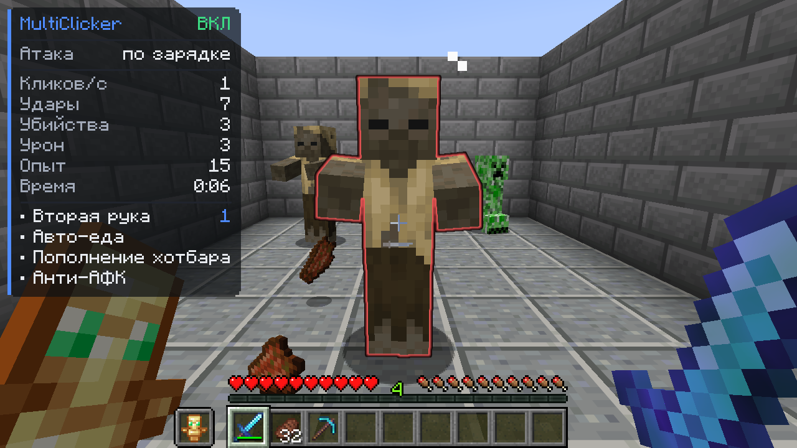

</div>

Мод-автокликер для Minecraft 1.19 – 26.3 (Fabric, NeoForge и Forge). Нажимает клавиши атаки, использования и прыжка в заданном
ритме. Включает модули для AFK-ферм, копания, огорода и рыбалки: авто-еда, авто-рыбалка, автоферма,
авто-инструмент, пополнение хотбара, вторая рука, аварийная остановка, анти-АФК и другие. У каждого
модуля, канала кликера и профиля может быть своя горячая клавиша.

## Быстрый старт

1. Установите [Fabric Loader](https://fabricmc.net/use/), [NeoForge](https://neoforged.net/) или
   [Forge](https://files.minecraftforge.net/) для своей версии Minecraft. Поддерживаются 1.19 – 1.19.4,
   1.20 – 1.20.6, 1.21 – 1.21.11 и 26.1 – 26.3
   (см. [версии](#поддерживаемые-версии)).
2. Положите в папку `mods` jar под свой загрузчик и диапазон версий из
   [последнего релиза](https://github.com/Shamanalle/MultiClicker/releases/latest):
   - Fabric: `MultiClicker-fabric-<версия мода>+1.19-1.20.4.jar` или `+1.20.5-1.21.11.jar` вместе с
     [Fabric API](https://modrinth.com/mod/fabric-api). По желанию поставьте
     [Mod Menu](https://modrinth.com/mod/modmenu): он добавляет кнопку настроек в списке модов.
   - Quilt: тот же jar Fabric, с Quilt Loader 0.30 или новее и Fabric API.
   - NeoForge: `MultiClicker-neoforge-<версия мода>+1.20.2-1.21.11.jar` (для 1.20.1 — jar Forge
     `+1.19-1.20.1`), больше ничего не нужно. Кнопка настроек есть в списке модов.
   - Forge: `MultiClicker-forge-<версия мода>+1.19-1.20.1.jar` или `+1.20.2-1.21.11.jar`, больше ничего
     не нужно.
   - 26.1 – 26.3 на любом из трёх загрузчиков: `MultiClicker-<версия мода>+26.1-26.3.jar` (на Fabric вместе
     с Fabric API).
3. Зайдите в мир, нажмите <kbd>O</kbd>, чтобы открыть меню, и <kbd>I</kbd>, чтобы включить или выключить мод.

Выберите готовую настройку в **Профили → Пресеты** и нажмите <kbd>I</kbd>:

| Пресет | Что настраивает |
|:--|:--|
| **Моб-ферма** | Атака на полной зарядке с небольшой случайной задержкой. Мирные мобы, питомцы и мобы с биркой не трогаются. Включены авто-еда и анти-АФК. |
| **Копание** | Клавиша атаки зажата, блоки ломаются, авто-инструмент берёт кирку, при полном инвентаре кликер останавливается. Включена авто-еда. |
| **Рыбалка** | Кликер выключен, авто-рыбалка подсекает и снова забрасывает. Включены авто-еда и анти-АФК. |
| **Ферма** | Кликер выключен, автоферма собирает созревший урожай вокруг и сажает заново, пополнение хотбара подкладывает семена. Включена авто-еда. |
| **AFK на месте** | Кликер выключен. Анти-АФК только приседает, взмахивает рукой и переключает слот хотбара, так что вы не сходите с места. |

Свои настройки можно сохранить в профиль: загружать его горячей клавишей, автоматически при входе
на сервер или поделиться им с другими одной строкой текста.

> На многих серверах автокликеры запрещены. Проверьте правила, прежде чем играть с модом по сети.

## Возможности

У каждой опции в меню есть подсказка. Правый клик по настройке сбрасывает её.

### Автокликер
- **Три канала: атака (ЛКМ), использование (ПКМ) и прыжок.** Каждый умеет *кликать* или *держать*
  клавишу, у каждого своя скорость, время удержания, пауза, случайная задержка и горячая клавиша.
- **Скорость в тиках или в кликах в секунду.** Задайте интервал в тиках или темп вроде 12 кл/с: доли
  тика переносятся, так что темп держится в среднем.
- **Случайная задержка на выбор.** *Равномерная* (любое значение до максимума), *колокол* (ровный ритм
  около середины) или *естественная* (чаще коротко, изредка пауза подольше, как у человека).
- **Ждать полной зарядки.** Бьёт только заряженным оружием, чтобы урон был максимальным. Для PvP
  в стиле 1.8 это выключается.
- **Цели.** Только разрешённые существа, существа и блоки (копание) или что угодно, даже в воздух.
- **Пауза при использовании.** Не бьёт, пока вы едите, пьёте, закрываетесь щитом или тянете лук. Если её выключить,
  поднятый щит на миг опускается, чтобы удар прошёл.
- **Добивать «Добычей».** Предсказывает, убьёт ли следующий удар моба. Если да, берёт из хотбара оружие
  с лучшей «Добычей», ждёт его зарядки, бьёт и возвращает прежний слот.
- **Задержка старта**, **лимит атак** и **лимит времени**: по их исчерпании мод выключается сам.
- **Работать в фоне.** Игра не встаёт на паузу, когда окно теряет фокус.
- **Фиксировать камеру.** Движение мыши не поворачивает камеру, пока мод включён.
- Клавиши, которые вы держите сами, не отпускаются. При открытом экране кликер на паузе.

### Фильтр целей
Игроки, враждебные, нейтральные и мирные мобы и прочие сущности (лодки, вагонетки, стойки для брони,
кристаллы Энда) включаются по отдельности. Дополнительно можно не трогать детёнышей, мобов с биркой,
питомцев и невидимых. Игроков в творческом режиме мод не бьёт: они не получают урона. Игроки по умолчанию
выключены; если прицел задержится на игроке, уведомление один раз подскажет, где их включить.

### Выживание
- **Безопасность.** Останавливает мод или выходит с сервера, когда здоровье падает до порога, при
  любом уроне или когда рядом появляется другой игрок.
- **Вторая рука.** Держит один предмет по приоритету: тотем при малом здоровье, еда при голоде,
  факел к кирке, иначе щит. Может и чередовать предметы с «Починкой»: повреждённый остаётся во второй
  руке, пока не починится, затем его место занимает следующий, так что опыт с фермы чинит их все.
- **Авто-еда.** Ест лучшую безопасную еду из хотбара, затем возвращается на прежний слот. Может пропускать вредную еду
  (гнилую плоть, иглобрюха, подозрительное рагу…) и золотую. Никогда не открывает сундук, дверь или
  торговлю жителя, на которых вы смотрите.
- **Авто-зелья.** Пьёт или бросает зелья из хотбара: исцеление или регенерацию при малом здоровье,
  огнестойкость, когда вы горите или стоите в лаве. Взрывные зелья могут идти первыми.
- **Авто-возрождение.** При смерти останавливает мод, пишет координаты смерти в чат и через секунду
  возрождается (в хардкоре — никогда).

### Автоматизация
- **Авто-рыбалка.** Подсекает при поклёвке через заданное время реакции, забрасывает снова,
  перезабрасывает, если долго нет поклёвки, останавливается, когда удочка почти сломана или
  после заданного числа уловов. Удочка может быть в любой руке. HUD показывает, в открытой ли воде
  поплавок: только там ловятся сокровища.
- **Анти-АФК.** Прыжок, присед, взмах рукой, поворот камеры, шаг или мгновенная смена слота хотбара через
  случайные интервалы между минимумом и максимумом. Каждое действие можно отключить. Присед, взмах и смена
  слота не сдвигают вас с места; смена слота засчитывается даже на серверах, которые не замечают взмахи и
  повороты головы.
- **Авто-ходьба.** Идёт вперёд, при желании бежит и перепрыгивает препятствия.
- **Автоферма.** Собирает созревшие пшеницу, морковь, картофель, свёклу, незерский нарост, какао и
  сладкие ягоды вокруг вас (или только под прицелом) и снова сажает их из второй руки, хотбара или инвентаря.
  Пока ничего не созрело, может удобрять растущий урожай костной мукой.
- **Пополнение хотбара.** Когда последний предмет стака на хотбаре израсходован или инструмент сломался,
  такой же предмет переносится из инвентаря; стак можно добирать и заранее. Инструмент или оружие в
  руке меняется на запасной, пока не сломался, так что инструмент с «Починкой» сохраняется.
- **Очистка инвентаря.** Выбрасывает предметы из списка мусора по одному стаку. Хотбар не трогает,
  пока вы не разрешите.

### Копание
- **Правила копания.** Белый или чёрный список блоков, которые кликеру можно ломать. Список
  редактируется в редакторе с иконками предметов. Может останавливаться при полном инвентаре и беречь
  инструмент в руке от поломки.
- **Авто-инструмент.** Берёт из хотбара самый быстрый инструмент для блока (с учётом «Эффективности»),
  пропускает почти сломанные и потом возвращает слот.

### Сессия
- **Авто-переподключение.** Когда соединение потеряно, ждёт, снова заходит на сервер, загружает его
  профиль и включает мод обратно. Может возвращаться и после кика за бездействие, но никогда — после
  бана, входа с другого места, аварийного отключения или выхода вручную.
- **Цель сессии.** Убийства, улов, урожай, добытые блоки, опыт и другое — до заданного числа: полоса
  прогресса в HUD, уведомление, когда цель достигнута, и мод может сам выключиться.
- **Уведомления.** Сообщение над хотбаром или в чате со звуком, когда во время работы мода что-то
  требует внимания: инвентарь заполнен, инструмент в руке вот-вот сломается, последний предмет в руке
  закончился, авто-еда не нашла еды, рядом появился игрок, поймана рыба или мод сам остановился (и
  почему). Каждое можно выключить. Важные можно отправлять и в **Discord-вебхук**, чтобы знать, что
  происходит, пока вас нет.

### Интерфейс
- **Обзор.** Первая страница меню: включён ли мод, сессия, цель, все модули в виде плашек (клик
  переключает, правый клик открывает настройки) и конфликты горячих клавиш.
- **HUD.** Панель состояния нужного масштаба: загруженный профиль, активные каналы, клики в секунду,
  удары, убийства, урон, улов, урожай, время сессии (по желанию — со скоростью в час), цель, пинг, TPS
  сервера, FPS и список активных модулей. Любую строку можно скрыть. Панель ставится в угол или
  перетаскивается куда угодно в редакторе HUD: она прилипает к краям и центру экрана.
- **Подсветка цели.** Существо, которое сейчас ударят, обводится контуром, заливается или светится
  выбранным цветом.
- **Меню.** Категории, сворачиваемые карточки модулей, поиск (в том числе по английским названиям),
  подсказки со значением по умолчанию и редактор списков с иконками предметов. По клику на число можно
  ввести точное значение; изменённые настройки отмечены точкой, а весь модуль сбрасывается кнопкой ↺.
  До любой настройки можно добраться с клавиатуры. Подстраивается под размер окна; на маленьком экране
  боковая панель превращается в иконки.
- **Обратная связь.** Цвет акцента, звук и сообщение над хотбаром при включении и выключении мода.
- **Статистика.** Что сделал мод, с сохранением между играми: за сессию, по каждому серверу и за всё
  время, плюс последние 20 сессий. Клики, убийства по мобам, урон и DPS, улов по видам и предметам,
  урожай, добытые блоки, еда, тотемы, смерти, опыт и другое, со скоростью в час. Для текущей сессии —
  график реальных кликов в секунду против заданных за последнюю минуту и диаграмма по минутам. Урон
  измеряется по здоровью мобов, поэтому он точный; если сервер скрывает здоровье, мод так и пишет, а не
  угадывает. Экспорт в CSV, сброс вторым нажатием и итог сессии в чате при выключении.
- **Горячие клавиши.** Любому модулю, каждому каналу кликера и каждому профилю можно назначить клавишу
  (или боковую кнопку мыши), которая переключает его прямо в игре. При загрузке профиля или пресета
  горячие клавиши не меняются. Клавиша, которая занята ещё чем-то, подсвечивается.
- **Профили.** Настройки сохраняются под именем и загружаются позже: горячей клавишей или сами при
  входе на нужный сервер или в одиночную игру. Профиль можно скопировать строкой текста, чтобы
  поделиться, и вставить чужой.

## Скриншоты

| | |
|:--:|:--:|
| 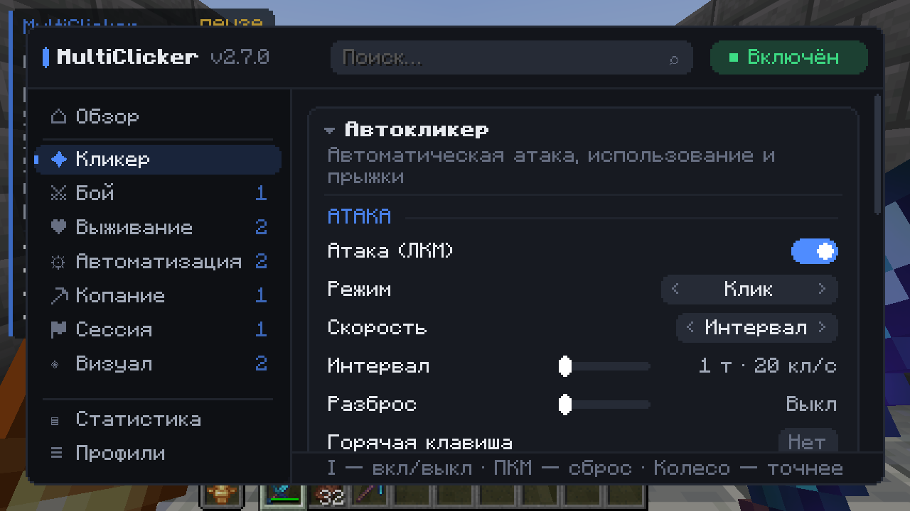 | 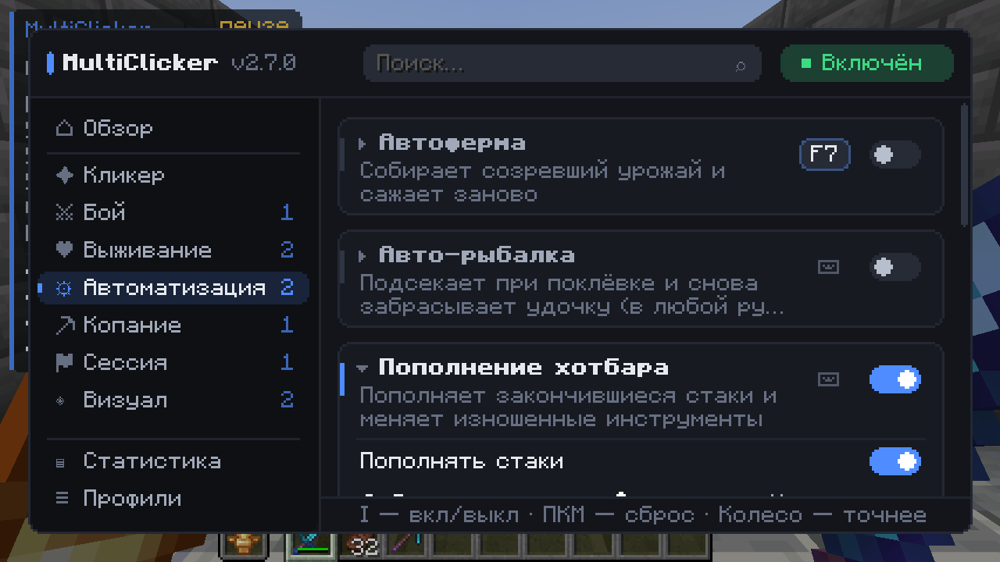 |
| Настройки: у каждого модуля своя карточка, у каждой опции подсказка | Автоматизация: автоферма с горячей клавишей, авто-рыбалка |
| 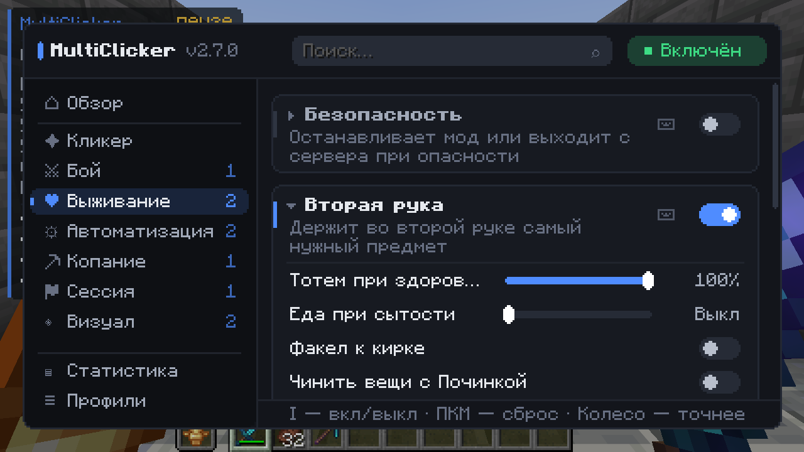 | 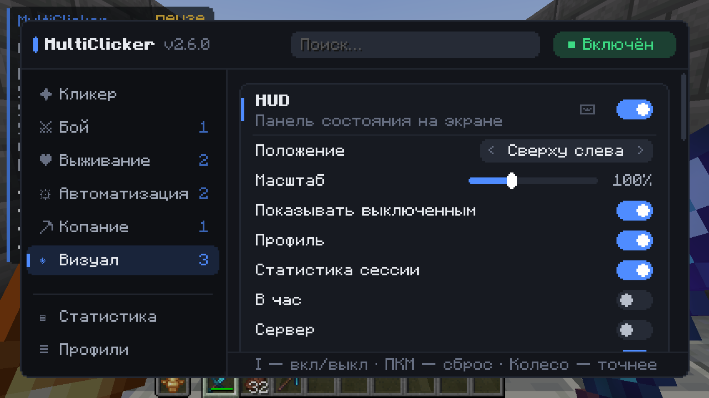 |
| Выживание: безопасность, вторая рука и авто-еда | Визуал: HUD и подсветка цели |
| 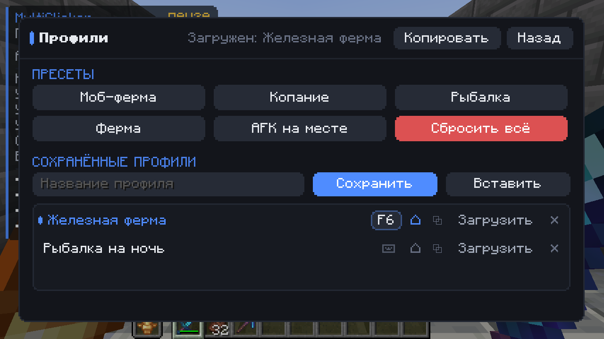 | 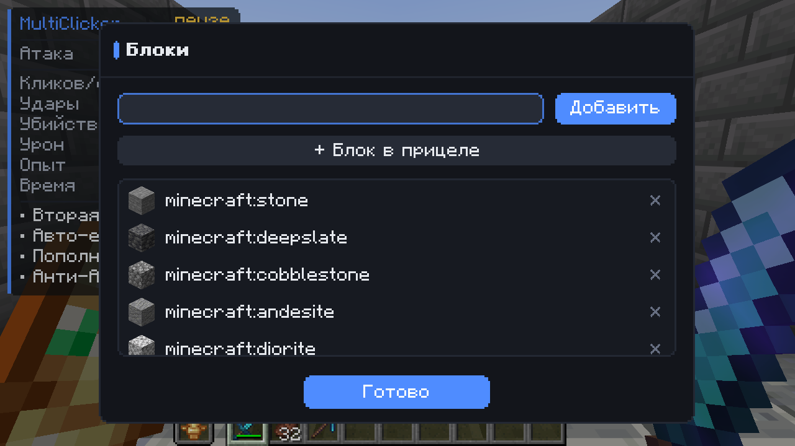 |
| Пресеты и свои профили: горячая клавиша, сервер, обмен | Редактор списков: иконки предметов, добавление предмета из руки или блока в прицеле |
| 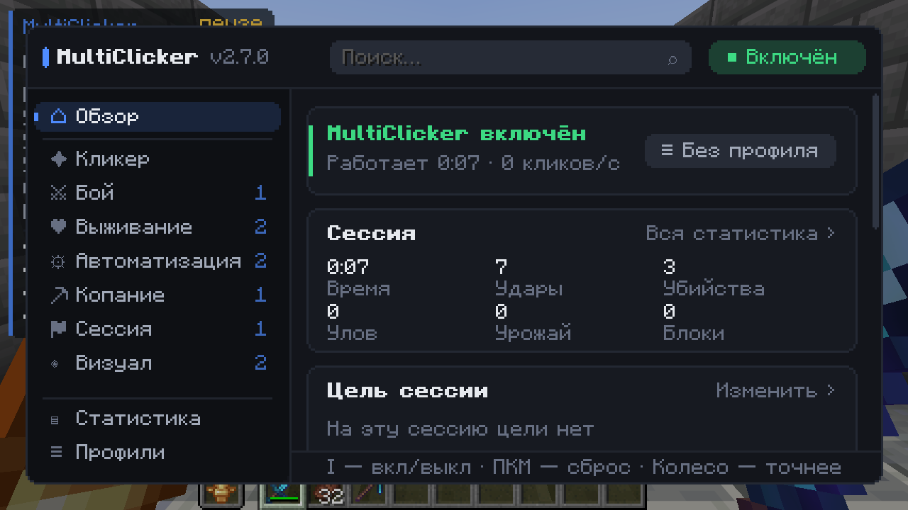 | 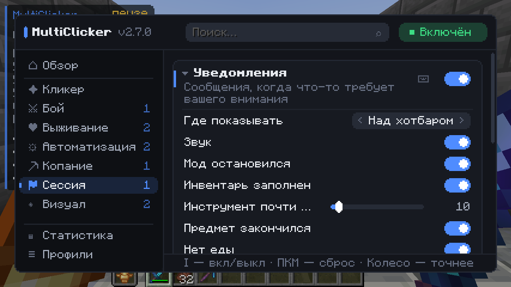 |
| Обзор: статус, текущая сессия и её цель с первого взгляда | Сессия: уведомления, когда что-то требует внимания |
| 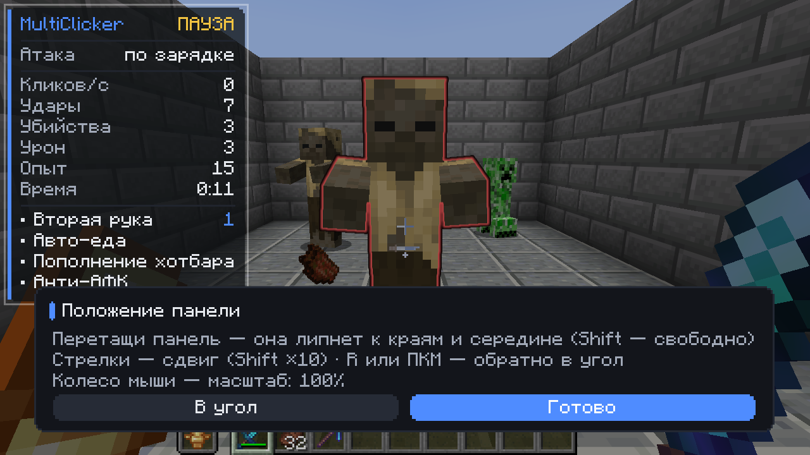 | 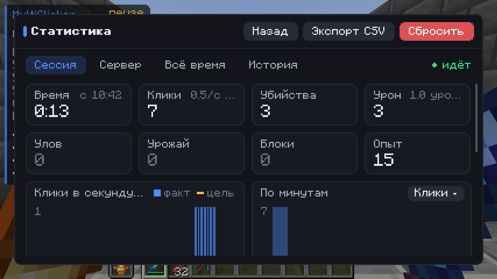 |
| Редактор HUD: перетаскивание панели, прилипание к краям, масштаб колесом | Статистика: сессия, каждый сервер и всё время, с графиками и темпом в час |

## Поддерживаемые версии

Все версии покрывают шесть jar: два для Fabric (1.19 – 1.20.4 и 1.20.5 – 1.21.11), два для Forge
(1.19 – 1.20.1 и 1.20.2 – 1.21.11), один для NeoForge (1.20.2 – 1.21.11) и один для 26.1 – 26.3 на всех трёх
загрузчиках. Внутри каждого jar лежит сборка под каждую версию его диапазона, и запускается та, что сделана
для текущей игры:

| Minecraft | Fabric | NeoForge | Forge |
|:--|:--:|:--:|:--:|
| 1.19 – 1.19.4 | ✓ | — | ✓ |
| 1.20 | ✓ | — (NeoForge начинается с 1.20.1) | ✓ |
| 1.20.1 | ✓ | ✓ (NeoForged Forge 47.1) | ✓ |
| 1.20.2 – 1.20.4 | ✓ | ✓ | ✓ |
| 1.20.5 | ✓ | ✓ | — (Forge для 1.20.5 нет) |
| 1.20.6 | ✓ | ✓ | ✓ |
| 1.21 – 1.21.1 | ✓ | ✓ | ✓ |
| 1.21.2 | ✓ | ✓ | — (Forge для 1.21.2 нет) |
| 1.21.3 – 1.21.11 | ✓ | ✓ | ✓ |
| 26.1 – 26.3 | ✓ | ✓ | ✓ |

Для Minecraft 1.21.9 и новее нужен Fabric Loader 0.17 или новее. Jar для Fabric работают и на
[Quilt](https://quiltmc.org/) Loader 0.30 или новее вместе с Fabric API. NeoForge для 1.20.1 — это форк
Forge 47 от NeoForged (ещё с API Forge), поэтому для него подходит jar Forge для 1.19 – 1.20.1.

- Fabric 1.21.4 и новее: каждая сборка проходит игровые тесты.
- Fabric 1.19 – 1.21.3 и все версии NeoForge: CI проверяет, что игра запускается с модом и все миксины
  применяются.
- Forge: CI запускает релизный jar в настоящей игре и проверяет то же самое.
- Шесть общих jar собираются в каждом пул-реквесте и запускаются в настоящей игре на всех загрузчиках
  и версиях, для которых публикуются; на Quilt jar для Fabric запускаются на самой старой и самой новой
  версии своего диапазона.
- Fabric 1.21.9: стили подсветки «контур» и «заливка» не рисуются (в Fabric API для этой версии нет
  событий отрисовки мира), «свечение» работает. На всех остальных версиях и загрузчиках работают все стили.
- До 1.19.3 в полях поиска нет серой подсказки.

## Управление

| Клавиша | Действие |
|:--:|:--|
| <kbd>I</kbd> | Включить / выключить мод |
| <kbd>O</kbd> | Открыть настройки |

Клавиши меняются в *Настройки → Управление → Назначение клавиш → MultiClicker*. Горячие клавиши модулей
и каналов назначаются в меню: кнопка ⌨ на карточке модуля или строка *Горячая клавиша* у канала;
клавиши профилей — в разделе *Профили*. Пока открыто меню или чат, горячие клавиши не срабатывают.

В меню можно просто начать печатать, чтобы найти настройку, <kbd>Tab</kbd> переключает категорию,
колесо мыши и стрелки точно подстраивают ползунки, а по клику на число его можно ввести. Без мыши:
<kbd>↑</kbd> / <kbd>↓</kbd> выбирают настройку, <kbd>←</kbd> / <kbd>→</kbd> меняют её, <kbd>Enter</kbd>
открывает ввод числа или переключает флажок, а <kbd>Backspace</kbd> сбрасывает на значение по умолчанию.

## Языки

English, Русский, Українська, Deutsch, Français, Español, Português (Brasil), Polski, Italiano,
Türkçe, 简体中文, 日本語, 한국어. Предметы, чары и мобы в каждом языке называются так же, как в самой игре.

## Настройки

Настройки хранятся в `config/multiclicker.json`, профили в `config/multiclicker/profiles/`.
Горячие клавиши и серверы профилей лежат в `multiclicker.json`, поэтому чужой профиль никогда не приносит
чужих клавиш. Настройки старых версий переводятся в новый формат при загрузке; файл из более новой
версии перед сохранением копируется в `multiclicker.json.v<N>.bak`.
Статистика хранится в `config/multiclicker/stats.json`, экспорт в CSV сохраняется рядом.

## Сборка

Нужен JDK 21 (для Minecraft 26.1 и новее — JDK 25 и Gradle 9). Версия выбирается через
`-Pminecraft_version=<версия>`; каждая описана в `versions/<версия>.properties`.

```bash
./gradlew build                       # → fabric/, neoforge/ и forge/build/libs, плюс юнит-тесты
./gradlew :common:test                # только юнит-тесты: тайминги кликов, профили, файлы настроек
./gradlew :fabric:runClientGameTest   # запускает игру и проигрывает все сценарии
```

- `common/` содержит сам мод: модули, настройки, меню и конфиг.
- `fabric/`, `neoforge/` и `forge/` содержат точки входа загрузчиков; каждый собирается для версий, в
  свойствах которых указан его загрузчик (`neoforge_version`, `forge_version`).
- `common/src/test/` содержит юнит-тесты, им не нужна запущенная игра.
- `fabric/src/gametest/` содержит игровые тесты. В релизный jar они не попадают.

## Лицензия

[MIT](LICENSE).
